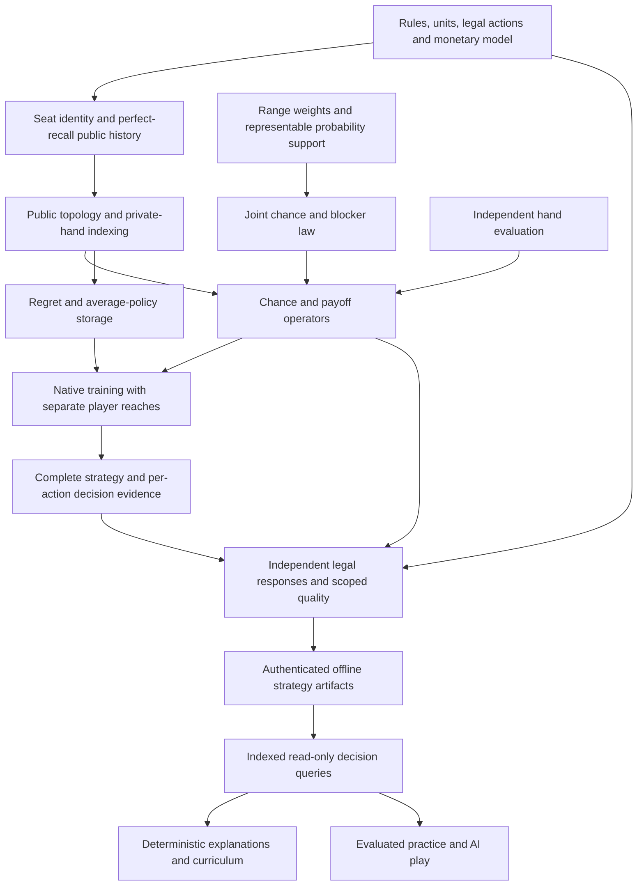

# Foundation-first audit and execution register

Owner directive: October 26, 2026. Audited GitHub main:
`901726e55caa0c45495b19668285162a04918cdc` (merged native four-street PR #243).
The assessment below distinguishes source inspection, historical retained results,
new execution, and proposed gates. This is a repository-wide dependency review,
not a claim that every line or possible poker state has been formally verified.

## Destination and readiness decision

The destination is a commercially practical heads-up no-limit Hold'em learning
product: coherent four-street strategy, immediate study feedback, deterministic
explanations, and eventual evaluated practice hands. A fast small conditioned game
is a useful laboratory, not that destination. Preserve the working engine and
its evidence; do not extend its literal complete-world representation into a
full-deck engine by increasing caps.

**Ready:** bounded research and controlled representation experiments after the
numerical containment below. **Not ready:** full-deck four-street solving, arbitrary
real-hand evaluation, or a commercial solver-backed curriculum. Chance/payoff
factorization, information/action storage, legal-game coverage, scalable quality
validation, and saved decision evidence remain critical dependencies. Passing
existing tests alone cannot discharge them.

Sol owns architecture and integration; a second Sol reviewer independently audited
the mathematics; Luna inspected product boundaries and implemented the bounded
probability prototype. Terra was unavailable, so root handled the difficult
numerical investigation and containment. Model assignments alone are not evidence:
the independent tests and executed records are retained below.

## Foundations to preserve

| Foundation | Assessment and evidence | Limit |
| --- | --- | --- |
| One coupled four-street game | `preflop_solver.py` grafts postflop continuations before training one root; SB/BB identity reverses local postflop position correctly. [Integration review](unified-solver-integration.md) and [facade](four-street-solver.md) describe the boundary. | Selected complete outcomes and finite action menus. |
| Hidden information and chance | Own-hand/public-history keys exclude opponent hands and future cards. One joint blocker-conditioned law is normalized globally; selected outcomes can change private-pair priors. Independent replay checks legal visible-information responses. | Newly reproduced extreme-weight underflow required containment; no blanket numerical proof. |
| Native repeated computation | Project-owned C++ uses contiguous arrays, depth scratch, strict FP, overflow/admission checks, source/build manifests and no per-iteration heap allocation. [Native result](native-four-street-result.md) retains equal-work/equal-policy complete calls. | Historical 66.615 ratio of medians covers one 22-world game; Python still prepares worlds and computes diagnostics. No general speed/RSS claim. |
| Independent validation | Numeric physical replay, exact normalized-policy certificates, known Kuhn controls, off-path rows, refunds and normalization ledgers already exist. | A floating BR is not a formal error bound; a normalized-policy certificate is not exact-decimal poker; large-game certification is unresolved. |
| Specialized exact reductions | [Matrix-free river](matrix-free-river.md), [turn](matrix-free-turn.md), [ranked payoffs](ranked-river.md), and [fixed-flop classes](flop-public-classes.md) preserve useful scoped operators. | Exact suit equivalence must include ranges, player roles, reaches and history. Standalone street equilibria cannot be spliced into a whole-game equilibrium. |
| Deterministic coach separation | Contracts separate calculations, evidence, explanation and presentation. The current practice estimate has explicit limits; [system overview](architecture/SYSTEM_OVERVIEW.md) maps producers and consumers. | Current practice EV is not solver evaluation of the live hand. |

The historical documentation can lag current source. For example, the dated
system overview calls public traversal Python-only; PR #243 subsequently added
the explicit native path. Follow dated pins and the later native specification.

Historical record authentication and proof reconstruction are separate gates.
The fixed-flop class publication's `authenticate_record()` inspects externally
pinned historical evidence; its original `authenticate()`/`verify()` still
require the original active source closure before execution. The upgraded
preflop verifier intentionally breaks that old source match. The old artifact
is preserved and authentic; this audit does not claim a fresh class-proof
reconstruction under the changed source. See the execution record for the
observed rejection and six explicit authentication controls.

## Dependency map and downstream rework

Changing chance conditioning later invalidates the meaning of every downstream
policy, gap, cache key and lesson. Changing history/action/monetary semantics can
invalidate policies, replay, action EVs and captured practice decisions. Changing
only a measured native kernel need not change those semantics. These first two
boundaries deserve priority over more training variants or user-facing features.
Removing pair/world storage still leaves public-tree and information-action
storage; neither is removed by a language change or a probability query alone.

## Ranked improvement register

Confidence means confidence in the finding, not proof an alternative will win.
Effort is relative (S: bounded change, M: multiple components, L: research program).

| ID / priority | Finding; status | Downstream impact / confidence | Benefit, effort, urgency |
| --- | --- | --- | --- |
| F01 P0 | Raw positive range products and chance division can underflow before normalization, deleting or materially changing supported deals. **Reproduced; contained** in four materialized producers. | Every regret, average, value, BR and explanation; high. | Correctness, S; immediate. Scale-safe normalization remains open. |
| F01b P0 | Legacy independent preflop replay disabled its evidence checks under optimized Python and duplicated premature product normalization. **Reproduced; corrected.** | Hidden-information/action/money/probability verification and quality gates; high. | Trustworthy acceptance, S; immediate. Other historical validators require their own review. |
| F02 P1 | Complete hidden worlds and public-prefix pair edges are still materialized before native training. **Proven target scalability blocker.** | Preparation, ranking, transport, CFR, diagnostics; high. | Removes a multiplicative representation barrier, L; resolve before broad-range/full-deck expansion. New probability seam is a partial experiment. |
| F03 P1 | Public topology and all information-action rows still grow with board/history/action branching. **Unresolved independently of F02.** | Regret/average arrays, output size and query corpus; high. | Potentially decisive memory/cost reduction, L; choose abstraction/decomposition only after a rank-free census. |
| F04 P1 | Finite menus omit legal actions; postflop opening sizes have no big-blind minimum. Current binary64/local-nine-decimal money differs from simulator integer chips. **Explicit model gap.** | All game identities, off-tree actions, real-hand evaluation and training lessons; high. | Prevents later semantic rewrite, M/L; specify before claiming actual-hand/general NLHE support. P0 against any such premature claim. |
| F05 P1 | Exact certificates have independent work/bit limits; numeric BR is not an arithmetic proof. **Separate scalability constraint.** | Experiment admission and quality publication; high. | Scalable trustworthy acceptance, L; establish a calibrated validation ladder with F02/F03. |
| F06 P1 | Serialized frequencies lack conditional per-action EVs, reach/applicability flags and local decision-loss evidence. **Source confirmed.** | Coach reasoning, grading, curriculum and live evaluation; high. | Educational capability, M; define evidence before building solver-backed lessons. |
| F07 P1 | No authenticated saved-strategy corpus/index/query path joins four-street solving to study. Facade source revision is explicitly unrecorded. **Source confirmed.** | Precomputation reuse, latency, reproducibility and economics; high. | Amortizes solving across users, M; schema after F04/F06, retrieval before synchronous web solving. |
| F08 P1 | Existing chance-sampled updates still materialize selected worlds and exact final diagnostics; all retained Hold'em targets in that study missed. **Historical evidence inspected.** | Algorithm choice and expected compute-to-quality; high. | Variance reduction/on-demand sampling may help, M/L; compare after representation seam, preserve every miss. |
| F09 P2 | Native backend is explicit and supports a bounded subset; legacy defaults remain Python. Build/IPC/preparation/diagnostic cost for larger cases is unmeasured. | Operational selection and full-call costs; high. | Profile phases before moving more code, M; never silently fall back. |
| F10 P2 | CPU parallelism/SIMD/GPU and alternate CFR/DCFR schedules lack same-game equal-budget evidence on intended scale. | Throughput, reproducibility, work models; medium. | Potential speed gains, M/L; downstream of memory/layout/representation. |
| F11 P2 | Hosting, worker admission, queueing, actual RSS, corpus storage and cost per active learner are unmeasured. Local server is intentionally loopback-only. | Commercial reliability and economics; high. | Required before hosted release, M/L; do not turn the research server into a public worker. |
| F11b P1 | Historical replay coupled complete source files to small unchanged helpers, preventing reviewed numerical repairs without breaking saved checks. **Reproduced; explicit transition layer implemented.** | Independent evidence, maintenance and acceptance of every future kernel change; high. | Preserve evidence while evolving code, M; source transitions require exact archives, semantic scope and current-operation guards. |
| F12 P3 | UI expansion, cosmetic refinements, additional abstractions and isolated micro-optimizations. **Deferred.** | Lower immediate foundation impact; high. | No prerequisite benefit established; defer behind P0/P1. |

### F01: numerical correctness and implemented containment

The parser accepts finite positive weights down to subnormals. Before this change,
`AsAh:1e-160,QsQh:1e-161` against `KsKh:1e-156`, conditioned on
`2c3d4h5s6c`, returned private-pair probabilities `[1,0]`. Exact normalization of
the parsed binary64 weights gives approximately `[0.9090909,0.0909091]`.
`AsAh:1e-160,QsQh:5e-161` against `KsKh:2e-156` returned `[.5,.5]`
instead of exact `[2/3,1/3]`. Both raw masses in the latter case were positive:
checking only zero would miss it. [Retained before-change evidence](../benchmarks/results/foundation-audit-v1/underflow-before.json)
records exact input fractions and the original source pin.

`probability_guard.normal_positive_mass` now rejects nonfinite, zero and subnormal
raw or normalized mass. `preflop_solver`, `postflop_solver`, configured river and
restricted river apply it before training. Pre/postflop reject before per-world
ranking; river rank arrays are prepared before the check. Accepted arithmetic,
reduction order, APIs and defaults are unchanged. This deliberately narrows the
numeric envelope; it does not calculate a repaired result or certify all normal
floating arithmetic. A caller can rescale weights where the intended ratios remain
representable. Normalization that preserves ratios across extreme scales needs
exact/exponent-scaled products, bounded conversion and independent equivalence
tests before integration. Existing exact-count and ranked normalization remain
separate and are preserved.

The regression covers erased support, distorted positive support, flop/turn/river
starts, both river routes, normalized subnormals and an ordinary complete-game
independent replay. Monte Carlo cumulative sampling precision is a separate open
audit item; this fix does not cover it.

The broader optimized run also reproduced a legacy verifier failure:
`scripts.preflop_validation` used `assert` for hidden-card, action, money,
probability and metric checks, so `python -O` removed them. All 17 predicates now
use explicit always-on checks, preserving `AssertionError` semantics. Its chance
reference now normalizes exact input products before one binary64 conversion,
independently detecting the producer's original prior bug. Configured binary64
action/terminal arithmetic and the 1e-10 comparison tolerance remain unchanged.
Candidate/oracle metric finiteness and finite nonnegative tolerance are checked
explicitly, preventing NaN from hiding inside an ordered maximum. Adversarial
tests run in an actual optimized subprocess. Three related legacy tools
(`flop_checkdown_validation`, `preflop_push_fold_validation`, and
`preflop_monetary_validation`) received the same mechanical hardening: 67 further
predicates, with original predicates/messages/math independently confirmed by
complete restored-AST equality. Synthetic trusted-count controls reject 17
malformed payloads/references in each normal/optimized subprocess. These tests
establish rejection mechanics, not physical count provenance or solver quality.
The four named tools now retain these checks in optimized mode; other validators
are not implicitly certified, and historical source-pinned records were not rewritten.

Full CI exposed F11b: older records pin whole source files even when a historical
consumer only uses the unchanged independent hand-ranker. The integration now
authenticates inert archived source, exact reviewed current bytes, and the rank
functions plus their imports. It does **not** assert equivalence of the repaired
chance normalizer or policy acceptance rules. Historical postflop compatibility
is separately limited to the unchanged normal-mass arithmetic path; underflow
continues to reject. Provenance-only wrapper edits have exact old/current pins
and AST comparison outside named provenance functions. Both LF and CRLF historical
hashes are recognized only through those authenticated bytes. Unknown matching
hashes, reversed turn transitions, changed archives, missing dependencies and
source changes during replay remain rejected. Final review also exposed stable
pre-existing edits to introduced helpers that operation-only hashes did not
bind to committed source. The shared source-transition gates now require the
bridge/archive closure to match one captured HEAD before reconstruction and
recheck that HEAD before returning. Raw operation hashes still detect changes
during replay. Current fingerprints include the new bridge, archives and
probability guard. Archived code is parsed
as inert evidence and never executed. See the
[integration receipt](../benchmarks/results/foundation-audit-v1/provenance-integration.json).

### F02/F03: decisive structural comparison and implemented prototype

Without enumerating boards, the literal full-support representation requires
`C(52,2)*C(50,2) = 1,624,350` ordered compatible private pairs and
`C(48,3)*45*44 = 34,246,080` canonical-flop/ordered-turn/river outcomes per pair:
**55,627,620,048,000 complete world rows**. A single eight-byte mass per such row
would require 445,020,960,384,000 bytes before trees, indices, signs, policies,
prefix duplication or allocator overhead. This is a payload illustration, not
measured RSS or an impossibility claim for poker algorithms.

A separate rank-free policy-storage calculation makes F03 concrete. For one
seat, every possible own hand plus canonical-flop/ordered-turn/river history
already yields `1326*C(50,3)*47*46 = 56,189,515,200` river rows. If both seats
store just one two-action decision at each such history, binary64 regrets and
average accumulators alone occupy **3,596,128,972,800 bytes**. Betting-history
multiplicity, earlier streets and every other array are excluded. This is an
explicit unabstracted table scenario, not measured memory or a lower bound on
all solver architectures. Chance factorization alone cannot resolve it.

The new research-only `FullDeckPrefixMass` snapshots concrete binary64 range
weights as exact fractions. For prefix length k=0,3,4,5 it computes absolute
joint masses and both private-hand marginal vectors under the **full-deck** law:

`pair_mass(i,j,B) = wi*wj / (Z*d_k)` for compatible hands avoiding B;
`d_k = 1, C(48,3), C(48,3)*45, C(48,3)*45*44`.

Z is the root compatible product mass. Filtering public cards followed by
per-card inclusion/exclusion, including the identical-holding add-back, avoids
pair and future-board arrays. One queried prefix takes O(H0+H1+52) rational
operations/entries; integer bit sizes and querying the full public tree are
separate costs. Individual pair lookup is constant in hand count. Marginals
remain correlated through blockers; their product is not the pair law. Flop
cards canonicalize together; turn and river retain reveal order.

Independent tests enumerate literal private pairs, conserve mass over all
22,100 possible unordered flops and all next-card reveals, test 1,326-hand deck
symmetry, tiny-positive support and exact side-rescaling. Separate Sol controls
retain 40 seeded models, 160 prefixes and 11,520 exact pair checks. The
[bounded measurement](../scripts/benchmark_foundation_prefix_mass.py) records
three construction-plus-four-query observations at 2/16/128/1326 hands per seat,
with independent checks outside the timer. See the
[retained report](../benchmarks/results/foundation-audit-v1/prefix-mass.json).

This is a new probability operator, **not an integrated full-deck solver**. It
does not rank, compute showdown values, retain reaches, build public decisions,
train, eliminate information-action memory or certify convergence. The current
selected-outcome game has a different conditioned law; speed/parity against its
22-world fixture would silently change the mathematical problem. The prototype
therefore makes no solver speedup, RSS, native or commercial latency claim.

## Candidate alternatives and evidence gates

| Decision | Current limitation / strongest credible alternative | Complexity, correctness and integration tradeoff | Smallest decisive acceptance |
| --- | --- | --- | --- |
| Numerical normalization | Premature binary64 product/division; exact or exponent-scaled products with one final conversion. | Extra bounded setup; protects relative mass. Conversion/support/tie-sensitive summation can alter trajectories. Immediate guard chosen to preserve admitted arithmetic. | Exact parsed-input posterior anchors, side-rescaling, subnormal/cancellation cases, independent saved-policy replay, no silent zero. |
| Chance/payoff representation | O(private pairs * complete outcomes) preparation, then prefix pair edges; on-demand public prefixes plus exact blocker/rank-vector terminal operators. | Probability prototype is linear per queried prefix. Showdown signs, correlated selected conditioning and both reach meanings are additional operators, not implied. Keep existing worlds as small-game reference. | Exact mass/utility/own-hand BR parity on genuinely same-law bounded games; public-prefix conservation, hidden-future adversaries and upstream-policy dependence. |
| Strategy storage | Full explicit tree and information-action arrays; exact suit quotient first, then justified action/card abstraction or public decomposition. | Quotient only when the full weighted game/reach/action structure is invariant. Abstraction adds error; decomposition needs counterfactual boundary values. | Rank-free topology/slots/serialization census over expanding supports, then full-policy physical replay with legal deviations and explicit abstraction error scope. |
| CFR family | Native alternating CFR+ is proven locally; DCFR/MCCFR with baselines or other variants are credible. | Cheaper sweeps can converge worse. Current sampled path retains setup/diagnostic bottlenecks and misses. No universal algorithm winner selected. | Same game/payoff/menus/quality oracle; all preregistered seeds; quality at equal wall-time and cost to same gap, setup/diagnostics included, misses retained. |
| Continual/subgame solving | Detached street solutions are not valid values; safe re-solving with opponent counterfactual values and documented error controls. | Can reduce online tree work, but requires coherent ranges/reaches, boundary guarantees and omitted-action handling. A learned evaluator adds training-data/model/error obligations. | First prove a small exact whole-game vs boundary/re-solve control; adversarial hidden information and off-tree actions. Do not introduce neural values now. |
| Native/layout/parallelism | Current native flat arrays are useful; more construction/diagnostics or parallel kernels only after phase profiles. | IPC/output and Python preparation may become dominant. Parallel reduction changes can alter regret trajectories; native work bounds must change with loops. | Paired complete calls at equal independently checked quality, raw timings, process RSS separate from Python traces, strict FP/sanitizer/compiled controls. |
| Precomputed education | No indexed solver corpus; immutable versioned artifacts plus read-only decision lookup and a separate worker for misses. | Storage/corpus growth and applicability matter more than another web solve endpoint. Keys must include legal/money/chance/range/history/action/value/quality identity, not just board/hand. | Query never invokes training, wrong model/unsupported/zero reach fail explicitly; deterministic replay and action EV units; proposed 100ms p95 lookup target measured on named hardware/corpus/load. |

Published methods constrain these choices; they do not prove our implementation.
[MCCFR](https://proceedings.neurips.cc/paper/2009/hash/00411460f7c92d2124a67ea0f4cb5f85-Abstract.html)
provides expectation-correct sampling schemes;
[variance reduction](https://arxiv.org/abs/1809.03057) motivates testing baselines;
[discounted regret minimization](https://arxiv.org/abs/1809.04040) motivates DCFR
comparisons. [DeepStack](https://www.kevinwaugh.com/pdf/deepstack17.pdf) describes
range/counterfactual-value re-solving boundaries, not detached scalar street EVs.
GTO Wizard's own [custom-solution description](https://help.gtowizard.com/how-to-build-custom-solutions/)
distinguishes a presolved library from configurable solving. That supports the
product pattern; no inference about its proprietary implementation or an
independently measured performance comparison is made. Research checked October
26, 2026; no third-party code/data/solver output was imported.

## Critical path, ownership and verification requirements

1. **Contain F01 now (root, independently reviewed by Sol).** Reject demonstrated
   probability distortion; test public routes and unchanged ordinary arithmetic.
   Retain original failures and run affected kernels plus normal/optimized checks.
2. **Prove the new chance seam (Luna implementation, Sol independent oracle).**
   Require exact prefix/pair/marginal agreement, zero local renormalization,
   complete-deck conservation/symmetry, immutable snapshots, input rejection and
   linear stored dimensions. The current experiment completes this limited gate.
3. **Resolve F03/F04 before a production representation migration (Sol design).**
   Rank-free census public nodes, private slots, action slots, rank/payoff/query
   demand and serialized bytes over support/boards/menu depth. Define chip unit,
   legal minimum/reopening/refunds/rake scope and omitted-action behavior. Keep
   old numerical model/version replayable. Do not lift caps as a substitute.
4. **Integrate one operator on the same mathematical game (bounded worker).**
   Add separated actual/counterfactual reaches and terminal vector payoffs, with
   independent physical utility/BR comparison and identical global normalization.
   Preserve a reference backend. Full-deck prefix mass alone does not pass this.
5. **Choose storage and algorithms from measured frontiers (Sol acceptance).**
   Evaluate quality at equal compute and compute at equal quality on held-out
   weighted/blocker/tie/short-stack/raised games; freeze thresholds/seeds/budgets
   first. Compare actual full-call wall time and memory, not just modeled loops.
   Existing exact tests calibrate a separately designed scalable validator.
6. **Publish deterministic decision artifacts (after F04/F06).** Include complete
   public history, acting own hand, legal action menu, conditional action EVs and
   units, quality/reach/support status, source/build/game identity and source
   policy hash. Reject source mismatch and unsupported actions. Off-path uniform
   fallback frequencies must not become confident coaching advice.
7. **Measure the study loop and economics (after corpus semantics).** Serve
   cached queries without training; explicitly queue supported misses. Measure
   p50/p95/p99, throughput, cache hit rate, actual worker RSS, serialized bytes,
   source-invalidations and deterministic grades. Cost per learner is a measured
   function of solve CPU time, solve reuse, storage and query/worker cost; no
   hosting price or profitable unit-economics claim is established here.

No new user-facing features, generic graph rewrite, GPU migration, approximate
value network or simulator merger is justified before the relevant gate. The
paused expanded-game runner was inspected as unfinished work and preserved in
its own checkout; it is not counted as a completed quality run or duplicated.
Historical river PRs #229-232 remain separate open candidate work at the live
inventory; their unmerged capabilities are not silently attributed to main.

## Execution record and maintenance

Completed source inspection: rules/configuration, monetary translation, hidden
information/chance, rank/equity boundaries, shared CFR/CFR+/DCFR and sampling,
native transport/layout/admission, matrix-free/class scopes, four-street facade,
server routes, persistence, practice and coach evidence. Recent non-Codex owner
chats were consulted for the frictionless study/personal-tool goal; their user
statements corroborate the supplied directive, not mathematical claims.

Completed action: F01 guard in four producers, independent regressions, an
isolated full-deck prefix operator and two independent control suites, structural
capacity calculation and retained measured prefix queries; F01b always-on legacy
replay and independent exact prior normalization. No existing frozen
study, cap, game rule, algorithm or production backend selection was rewritten.

Validation and publication receipts are maintained in
[the execution record](foundation-first-execution.md). Update this register when
an item changes status, with source revision, exact commands, full raw results,
failed gates and independent review. Planned gates above are not completed work.
